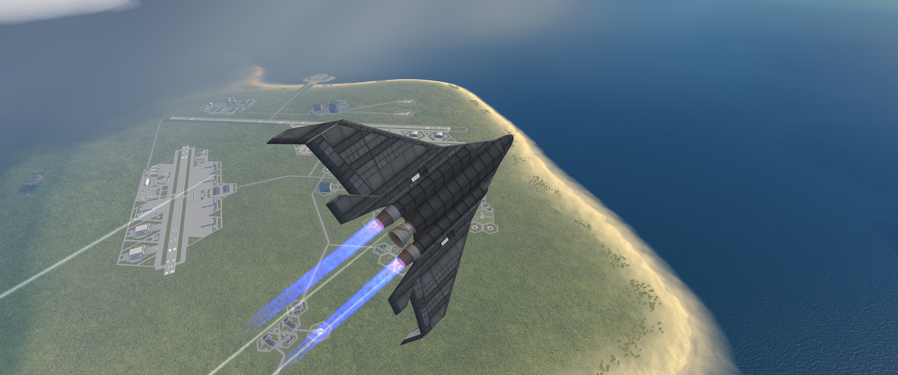

# Heat Tile Painter

Heat Tile Painter adds layered surface paint to the VAB and SPH in Kerbal Space Program 1.12.5.
Paint a heat-tile pattern or flat color directly onto a part, then adjust the side, coverage,
placement, rotation, edge, and layer order.

Paint stays with the craft through save and load, launch, revert, variant changes, and supported
procedural-part changes. The mod does not add decal parts or persistent overlay renderers.



## Requirements

- Kerbal Space Program 1.12.5
- ModuleManager

## Install

Download `HeatTilePainter-0.24.1.zip` from the [latest release](https://github.com/peachyGT/HeatTilePainter/releases/latest).
Copy the archive's `GameData` folder into the Kerbal Space Program folder and merge it with the
existing `GameData` folder.

The mod installs to `GameData/HeatTileOverlayPrototype`. That older folder name is kept so saved
craft and previous test builds continue to work.

## Use

1. Open Heat Tile Painter from the editor toolbar.
2. Choose Select, Eyedropper, Brush, Bucket, or Eraser.
3. Pick a pattern or Flat Color, then set the part-local side, coverage, surface wrap, mirror,
   opacity mask, and edge style.
4. Hover over the craft to preview the painted surface. Click to apply it.
5. Press `Esc` or choose Off to return to normal editor controls.

Select chooses the part whose layers appear in the panel. Eyedropper copies a part's full layer
stack. Brush adds the current layer, Bucket applies a linked layer across the craft, and Eraser
removes the selected or top layer.

Each part keeps an ordered layer stack. Layers can be hidden, copied, updated, deleted, or dragged
into a new order. Select a layer and use Move or Rotate for precise placement. The gizmos follow the
editor's current smooth or snap mode, including angles set by Editor Extensions. Reset returns the
layer to its selected side and centers its coverage plane.

## Paint and heat protection

The included paint choices are:

- B9 Legacy HRSI Panels
- B9 Wing-Scale HRSI
- B9 Wing-Scale HRSI Upscaled
- Shuttle HRSI Bricks
- Flat Color with RGB controls and several presets

Functional heat protection is optional for each painted part. It raises the internal temperature
limit by 35% and the skin limit by 50%, capped at 3000 K and 3300 K. The tradeoff is 5% more dry
mass. It does not add Ablator or change fuel resources. Remove All turns it off.

## Rendering and performance

Heat Tile Painter rebuilds the complete saved layer stack when paint changes or a craft loads. The
renderer partitions the part's existing mesh into material regions. This keeps paint off the
opposite side of models that reuse the same UV space for top and bottom surfaces.

Generated partitions are discarded before repainting. The next paint is always built from the
part's current source mesh, including settled procedural geometry. Flat Color also clears inherited
specular and metal maps inside its region so a matte color does not inherit a glossy finish.

One global scheduler handles restoration and repaint work at a limit of one painted part per frame.
There is no painter-specific frame callback on each part, no camera callback, and no flight polling.
The first use of an uncached texture or region can still pause the editor while it is baked.

## Current limits

- Mask opacity is saved, but the renderer does not interpret it yet.
- Textured gasket and Reinforced strip currently use the same smooth boundary as Soft fade. Their
  layer settings remain saved.
- Some complex multi-material parts cannot be split safely. They use a topology-preserving mask,
  so their source UV layout can still limit side isolation.

## Compatibility

Existing `layerData` from test versions 0.6 through 0.21 remains compatible. ReStockPBR, Textures
Unlimited, Shabby, Resurfaced, Technicolor, and Conformal Decals are not required. Heat Tile Painter
does not add controls to the flight part-action window.

## Credits and license

Heat Tile Painter is released under the MIT License. See [LICENSE](LICENSE).

The rendering and cache core is closely related to Reforged Materials Redux by J4COB, used under MIT. The HRSI
patterns include MIT-licensed artwork derived from B9 Procedural Wings. Reforged texture assets are
not included. Stock KSP Move and Rotate icons are read from the running game and are not
redistributed. See [THIRD-PARTY-NOTICES.txt](THIRD-PARTY-NOTICES.txt) and
[LICENSE-ASSETS.txt](LICENSE-ASSETS.txt) for the full notices.

Note that a lot of this mod was vibe coded.

## Build and test

Set `KSP_ROOT` to a KSP 1.12.5 installation, then run:

```powershell
powershell -NoProfile -ExecutionPolicy Bypass -File .\Tools\Invoke-QualityGate.ps1
```

The quality gate compiles the mod and checks its renderer contracts, geometry handling, event
delegates, placement controls, thermal balance, UI, package contents, and public metadata. Visible
paint, save behavior, and frame rate still need in-game testing.
